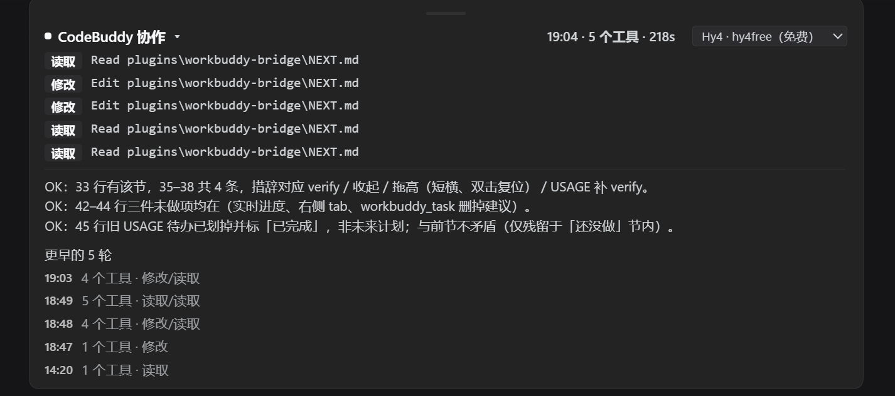
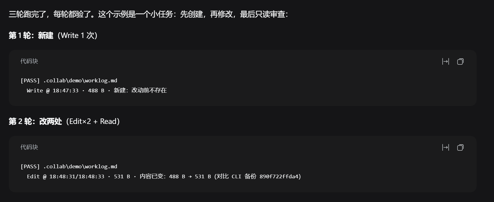

# CodeBuddy Bridge（DSH 插件）

把本机的 **CodeBuddy CLI** 接进 DeepSeek Harness：DSH 派活 → 它干活 → 结论回注对话 → **逐轮核对它到底改了什么**。
WorkBuddy 桌面版里内置的就是这套引擎，所以装了 WorkBuddy 也能直接用。

> 给模型看的用法写在 [USAGE.md](USAGE.md)；本文件是给人和市场审核看的。

## 长什么样

面板（每轮的读取/修改打点 + 结论，可收起、可拖高）：



核对输出（PASS / FAIL + 证据，不花额度）：



输入框下方的开关：


## 它解决什么

让一个 agent 干活、另一个 agent 验收，人只负责拍板和最后一眼。现在多数的“协作”停在“它说它改了”，
这个插件补上最后一环：**用 CLI 自己留的改前备份做内容 diff**，给出 PASS / FAIL 和证据。

## 前置条件

- Windows（引擎路径按 WorkBuddy 的安装位置自动探测；其它平台未测）
- 已安装 **WorkBuddy 桌面版**（自带 CodeBuddy CLI），或自己装的 `@tencent-ai/codebuddy-code`
- 可选：`dsh-connect-workbuddy` 插件——relay 路线（`/codebuddy`）由它提供；没有它时其余功能照常

插件**不接触、不保存、不转发任何凭据**：认证完全由 CodeBuddy CLI 自己处理。

## 安装

```bash
dsh plugin --profile web add dsh-codebuddy-bridge
```

从仓库装（未发 npm 时）：

```bash
dsh plugin --profile web add github:<owner>/<repo>
```

安装后重启 DSH，输入框下方会出现「CodeBuddy 协作」胶囊。

## 首次使用

1. 点开胶囊（按会话独立；关着时工具会从该会话的 agent 作用域里收走）；
2. 对模型说「让 CodeBuddy 把 X 改了」——它调 `workbuddy_relay(prompt, edit: true)`；
3. 结论会以消息回注到对话，输入框上方的面板列出每步（读取/修改/执行）；
4. 说「验一下」，模型调 `workbuddy_verify()`，得到 PASS/FAIL + 证据。

## 工具

| 工具 | 作用 |
| --- | --- |
| `workbuddy_relay(prompt, edit?, mode?)` | 代敲 `/codebuddy`，结论回注对话（需要 `dsh-connect-workbuddy`）；`mode="plan"` 是只读规划 |
| `workbuddy_review(path, focus?, maxFindings?)` | 只读审查一个文件：固定模板 + 自动核对它读没读、有没有写 |
| `workbuddy_verify(run?, session?)` | 核对某轮改没改：PASS/FAIL/WARN + 证据；不花额度 |
| `workbuddy_read(turns?, session?)` | 读 WorkBuddy 桌面版自己的会话记录 |
| `workbuddy_status()` / `workbuddy_close()` | 状态与会话管理 |
| `workbuddy_dispatch(task)` + `/dsh-handoff` | 老的文件交接兜底通道 |

**两种模式**：审计（`workbuddy_review`）查错——位置—问题—改法，最多 N 条、200 字内；
计划（`workbuddy_relay(mode="plan")`）想清楚——结论 / 约束 / 假设 / 候选路线 / 每条的反例 / 建议，
只读、不限字数，结论存到交换目录的 `plans\<时间戳>.md`。

`relay` 与 `review` 共用**每会话每小时 6 轮**的额度，超限直接返回 `{ rejected: true, retryAfterSec }`，
不调用 CLI、不花额度；`verify` / `read` / `status` 本地读文件，不占额度。

> 工具名沿用 `workbuddy_*`：它们对接的一直是这台机器上的 WorkBuddy/CodeBuddy 引擎，改包名时没有跟着改，避免老文档和老习惯全断。

## 配置

`cordis.patch.yml` 或插件设置里：

| 字段 | 默认 | 说明 |
| --- | --- | --- |
| `collabDir` | `~/.dsh/codebuddy-bridge` | 交换目录：轮次记录、模式开关、报告 |
| `permissionMode` | `acceptEdits` | 透传给引擎；`bypassPermissions` 为完全放行 |
| `cliPath` | 自动探测 | CodeBuddy CLI 入口，仅 Windows 默认路径 |
| `productConfig` | 自动探测 | 让入口以 WorkBuddy 身份工作 |
| `model` | 引擎默认 | 透传 `--model` |
| `timeoutMs` | 900000 | 单轮超时 |
| `watchMs` | 3000 | 兜底通道的轮询间隔 |
| `roundLimit` | 6 | 每会话每窗口最多几轮（`relay` + `review` 共用） |
| `roundWindowMs` | 3600000 | 窗口长度；从第一次计入的轮次起算，不滑动 |

## 权限与隐私

- **读**：`~/.codebuddy/projects/<slug>/<session>.jsonl`（CLI 自己的会话记录），用来生成面板和核对证据；
  以及 `~/.workbuddy/projects`（只有 `workbuddy_read` 读它）。
- **写**：`collabDir` 下的几个 jsonl/md（含 `limits.json` 额度账本与 `plans\` 下的计划结论）；引擎本身按 `permissionMode` 写工作区文件。
- **不碰**：账号 token、登录态文件、任何网络请求（网络只发生在 CodeBuddy CLI 内部）。
- 面板要显示明细，所以会话记录的“工具调用参数摘要”会进入 DSH 的对话上下文——敏感工作区请自行评估。

## 限制

- 同一时刻一个 CodeBuddy 会话只能跑一轮。
- 面板不在右侧边栏（第三方插件开不了那个位置），放在输入框上方。
- 没有“运行中”的实时进度，只有跑完后的明细。
- `workbuddy_verify` 只能核对**动作 + 文件事实**；它说得对但没做的、或者做了没说的，都会标出来，判断仍然要人来做。
- 节流按 **DSH 会话**计数：重启不会清零，但**开新会话会**（这是有意的边界，防的是同会话内失败重试）。
  固定窗口在两个窗口的交界处，理论上一小时内可过接近 2 倍名义值。
- 计划模式的结论只保证"落盘完整"；它的建议对不对，仍要人来判断。

## 开发

```bash
node --check index.js
node --check client.js
npm test        # node:test，覆盖 verify 的判定分支
```

改 `index.js`：插件管理里关开一次即可。改 `client.js`：**必须重启 DSH**（客户端模块只在启动时扫描）。

## License

MIT
